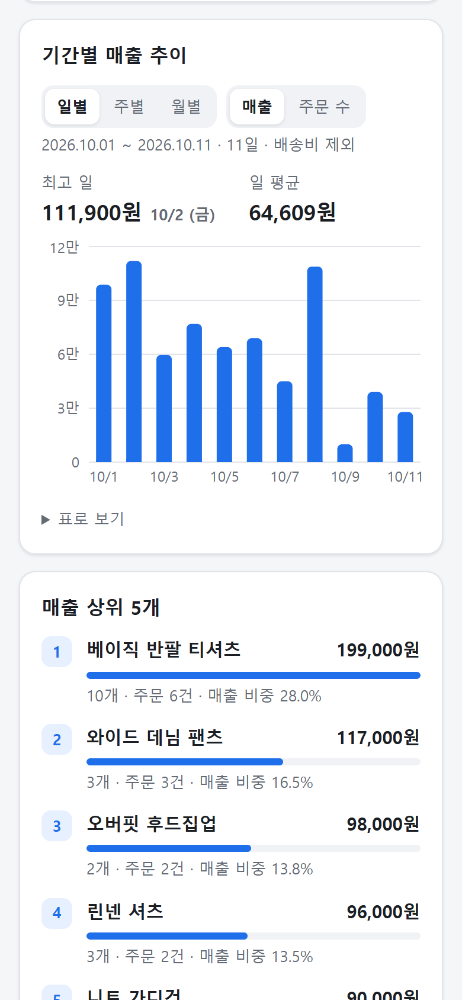
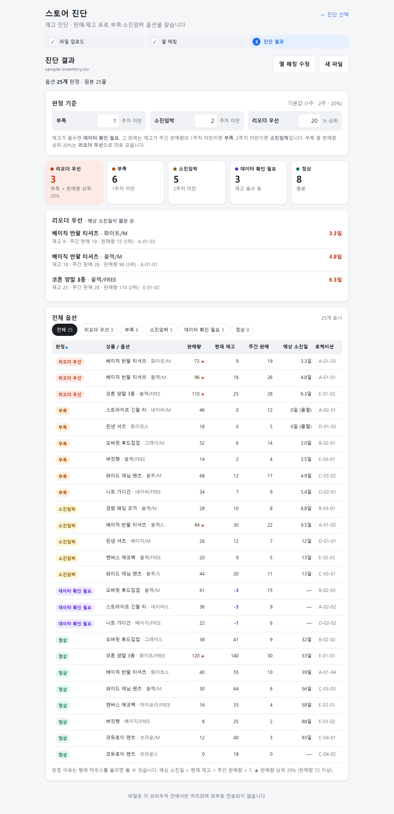
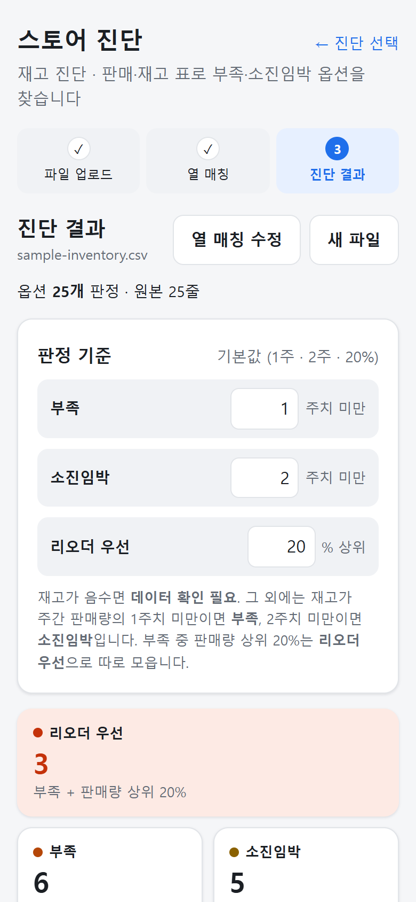
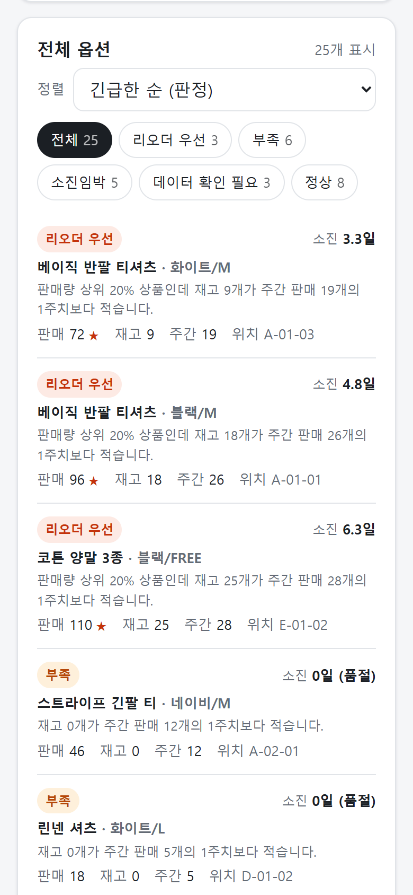

# 스토어 진단

쇼핑몰 엑셀을 올리면 **판매 상태**와 **재고 상태**를 바로 진단해 주는 웹앱입니다.

- **판매 진단**: 주문 엑셀 → 상품별 매출, 기간별 추이, 컬러별 판매 비중, 객단가
- **재고 진단**: 판매·재고 표 → 옵션별 부족·소진임박 판정, 리오더 우선 목록, 예상 소진일

파일은 브라우저 안에서만 처리되며 어디에도 전송되지 않습니다.

**🔗 데모:** https://store-diagnosis.vercel.app — 진단 종류를 고른 뒤 "샘플 데이터로 체험하기"를 누르면 바로 결과를 볼 수 있습니다.


### 판매 진단


<table>
  <tr>
    <th>1. 업로드</th>
    <th>2. 열 매칭</th>
  </tr>
  <tr>
    <td></td>
    <td></td>
  </tr>
</table>

<table>
  <tr>
    <th>모바일 · 요약</th>
    <th>모바일 · 기간별 추이</th>
    <th>모바일 · 컬러별 비중</th>
  </tr>
  <tr>
    <td align="center"></td>
    <td align="center"></td>
    <td align="center"></td>
  </tr>
</table>

### 재고 진단



<table>
  <tr>
    <th>모바일 · 기준과 요약</th>
    <th>모바일 · 전체 옵션 (카드형)</th>
  </tr>
  <tr>
    <td align="center"></td>
    <td align="center"></td>
  </tr>
</table>

## 만든 이유

의류 쇼핑몰에서 MD로 일하면서 판매 현황을 볼 때마다 주문 엑셀을 내려받아 수작업으로 정리했습니다.
피벗 테이블을 다시 만들고, 옵션 열에서 컬러를 손으로 나누고, 취소·반품 건을 걸러 내는 일이 매번 반복됐습니다.

쇼핑몰마다 엑셀 열 이름이 다르고, 매출로 착각하기 쉬운 "결제금액"이 사실은 주문 단위 금액이라
상품별로 합치면 숫자가 부풀려지는 문제도 있었습니다.

재고도 마찬가지였습니다. 이지어드민 등에서 판매·재고 표를 내려받아 옵션마다 "몇 주 버티는지"를 계산하고,
잘 팔리는데 재고가 모자란 옵션을 골라 리오더 목록을 만드는 일을 매주 손으로 했습니다.

이 반복 작업을 **진단 선택 → 파일 업로드 → 열 매칭 → 결과 확인**으로 줄이려고 만들었습니다.

## 주요 기능

### 공통

- **파일 업로드**: xlsx · xls · csv 지원. EUC-KR로 저장된 국내 쇼핑몰 CSV도 한글이 깨지지 않습니다.
- **열 매칭**: 열 이름을 보고 항목을 자동으로 추천하고, 사용자가 직접 고칠 수 있습니다.
- **실무 엑셀 대응**: 맨 위 제목 줄 자동 건너뛰기, 합계 행 제거, "12,900원" 같은 금액 문자열 인식
- **샘플 데이터로 체험하기**: 진단마다 가상 데이터로 결과를 바로 볼 수 있습니다.
- **모바일 대응**, 다크 모드. 주소의 `#sales` / `#inventory`로 진단 종류를 바로 열 수 있습니다.

### 판매 진단

- **열 매칭**: 주문번호 · 주문일시 · 상품명 · 옵션 · 수량 · 상품금액 · 주문상태
  - 상품금액은 "줄 금액 열"과 "판매가 × 수량" 중에서 계산 방식을 고를 수 있습니다.
  - 주문 단위 결제금액을 고르면 경고를 띄웁니다.
- **진단 결과**
  - 객단가 (상품금액 합계 ÷ 고유 주문 수, **배송비 제외 기준**)
  - 상품 매출, 주문 수, 판매 수량
  - **기간별 매출 추이**: 일·주·월별 막대 차트 (매출 / 주문 수 전환, 최고 구간·평균, 표로 보기)
    - 기간 길이에 맞춰 단위를 자동 선택 (한 달 이내 일별, 반년 이내 주별, 그 이상 월별)
    - 판매가 없는 날도 0으로 채워 실제 시간 간격을 그대로 보여 줌
  - 매출 상위 5개 / 하위 5개 (서로 겹치지 않게 표시)
  - 컬러별 판매 비중 도넛 차트 (수량·매출 기준 전환)
- **취소·반품·환불 제외**: 주문상태 열을 매칭하면 해당 줄을 빼고, 몇 줄을 뺐는지 보여 줍니다.
- 병합 셀로 비어 있는 주문번호·주문일시 이어받기, 여러 날짜 형식(`2026-10-01`, `2026.10.01`, `20261001`, `2026년 10월 1일`, 엑셀 날짜 셀) 인식

### 재고 진단

- **열 매칭**: 상품명 · 옵션 · 판매량 · 현재 재고 · 주간 판매량 · 로케이션(선택)
  - 같은 옵션이 로케이션별로 여러 줄이면 옵션 단위로 합쳐 판정하고, 로케이션은 목록으로 보여 줍니다.
- **옵션별 판정** (서로 겹치지 않음)

  | 판정 | 조건 (기본값) |
  |---|---|
  | 데이터 확인 필요 | 현재 재고 < 0 (판매량이 음수인 경우 포함) |
  | 리오더 우선 | 부족이면서 판매량 상위 20% 안 |
  | 부족 | 재고 < 주간 판매량 × **1주** |
  | 소진임박 | 재고 < 주간 판매량 × **2주** |
  | 정상 | 그 외 |

  - 기준 숫자(1주, 2주, 20%)는 결과 화면에서 바꾸면 바로 다시 판정합니다. 이 브라우저에 기억됩니다.
  - 판매량 상위 N%는 "판매량 순으로 ⌈옵션 수 × N%⌉번째 옵션의 판매량 이상"으로 정합니다 (동점 포함, 판매량 0 제외).
- **예상 소진일** = 현재 재고 ÷ 주간 판매량 × 7 (주간 판매가 없거나 재고가 음수면 표시하지 않음)
- **결과 화면**: 판정별 개수 카드(누르면 표 필터) → 리오더 우선 목록(소진일 짧은 순) → 전체 표(판정 필터, 열별 정렬, 판정 이유)
  - 모바일에서는 표가 카드형 목록으로 바뀌고, 정렬은 드롭다운으로 고릅니다.
- **리오더 우선 목록 엑셀 내려받기** (`리오더우선_YYYYMMDD.xlsx`, 브라우저에서 바로 생성)
  - 시트 1 "리오더 우선": 순번, 상품명, 옵션, 로케이션, 판매량, 판매 순위, 현재 재고, 주간 판매량, 예상 소진일,
    부족 수량(참고), 판정 이유. 숫자는 숫자 셀이라 엑셀에서 바로 정렬·합계 가능, 머리글에 필터 적용
  - 부족 수량(참고) = 주간 판매량 × 소진임박 기준(기본 2주) − 현재 재고 (올림). 발주량을 정할 때 참고용
  - 시트 2 "판정 기준": 원본 파일, 내려받은 시각, 적용한 기준 숫자

## 사용 기술

| 영역 | 기술 |
|---|---|
| 프레임워크 | React 18, TypeScript, Vite |
| 엑셀 파싱 | SheetJS (xlsx), TextDecoder (EUC-KR 판별) |
| 차트 | Recharts |
| 테스트 | Vitest (71개) |
| 스타일 | CSS 변수 기반 반응형 CSS |
| 배포 | Vercel (main 브랜치 push 시 자동 배포) |

서버 없이 정적 파일만으로 동작합니다.

## 실행 방법

Node.js 18 이상이 필요합니다.

```bash
npm install
npm run dev      # http://localhost:5173
npm test         # 단위 테스트
npm run build    # dist/ 에 배포용 파일 생성
```

## 폴더 구조

```
src/
├─ App.tsx                    # 진단 선택 (#sales / #inventory)
├─ types.ts
├─ lib/
│  ├─ parseFile.ts            # xlsx/csv 파싱, 인코딩 판별, 헤더 행 탐지
│  ├─ guessMapping.ts         # 열 이름으로 매칭 추천 (판매·재고)
│  ├─ normalize.ts            # "12,900원" → 12900, 취소/반품/환불 판별
│  ├─ parseOption.ts          # "색상=블랙, 사이즈=M" → 블랙
│  ├─ analyze.ts              # 판매 집계
│  ├─ dates.ts                # 주문일시 → YYYY-MM-DD
│  ├─ trend.ts                # 일·주·월 구간 집계
│  ├─ inventory.ts            # 재고 옵션 합치기, 판정, 예상 소진일
│  ├─ exportReorder.ts        # 리오더 우선 목록 → xlsx
│  └─ __tests__/
└─ components/
   ├─ ModeSelect.tsx          # 판매 진단 / 재고 진단 선택
   ├─ SalesApp.tsx            # 판매 진단 흐름
   ├─ MappingShell.tsx        # 열 매칭 공통 틀
   ├─ ...                     # 업로드, 요약 카드, 순위, 추이·컬러 차트
   └─ inventory/              # 재고 진단 흐름, 열 매칭, 판정 기준, 결과
public/
├─ sample-orders.csv          # 가상 주문 데이터 (개인정보 없음)
└─ sample-inventory.csv       # 가상 판매·재고 데이터 (재고 음수 3개 포함)
```

## AI와 작업한 방식

이 프로젝트는 **Claude Code**와 함께 설계하고 구현했습니다.
저는 요구사항과 판단 기준을 정하고, 결과가 실무 데이터에 맞는지 직접 검증했습니다.

**진행 방식**

1. 목적과 범위를 정해 전달하고, 폴더 구조와 작업 계획을 먼저 받아 검토한 뒤 구현을 시작했습니다.
2. 단계마다 진행 상황을 `WORK_STATUS.md`에 기록하게 해서 무엇이 끝났고 무엇이 남았는지 추적했습니다.
3. 집계·판정 로직은 단위 테스트로, 화면은 실제 브라우저(모바일 폭 포함)에서 확인했습니다.

**제가 직접 검증하고 방향을 바꾼 부분**

- **매출 기준을 결제금액에서 상품금액으로 변경**:
  처음 계획은 "결제금액" 열로 매출을 계산하는 것이었습니다.
  하지만 카페24 등 실제 쇼핑몰 엑셀의 결제금액은 주문 단위라, 한 주문에 상품이 여러 개면 줄마다 같은 금액이 반복되고 배송비·할인도 섞여 있습니다.
  그래서 상품별 매출은 줄 단위 상품금액(또는 판매가 × 수량)으로 계산하고,
  객단가는 상품금액 합계 ÷ 고유 주문 수로 "배송비 제외 기준"을 명시하도록 바꿨습니다.
- **취소·반품·환불 제외**:
  실제 판매 현황을 보려면 취소·반품 건을 빼야 한다고 판단했습니다.
  그래서 주문상태 열을 선택 항목으로 추가하고, 제외한 줄 수를 화면에 표시하도록 요구했습니다.
- **상·하위 목록 중복 처리**:
  상품 수가 적을 때 상위 5개와 하위 5개가 같은 상품으로 채워지지 않는지 확인했습니다.
  상품이 5개 이하면 하위 목록 대신 안내 문구를 보여 주고, 6~9개면 상위와 겹치지 않는 나머지만 보여 주도록 정리했습니다.
- **재고 판정 기준 설계**:
  MD 실무에서 쓰던 기준(1주치 미만 부족, 2주치 미만 소진임박, 판매 상위 20% 중 부족이면 리오더 우선)을 판정 규칙으로 정하고,
  재고 음수는 판정하지 말고 "데이터 확인 필요"로 따로 빼도록 했습니다.
  상품·시즌마다 기준이 달라서 숫자를 화면에서 바꿀 수 있게 요구했습니다.
- 샘플 데이터에 이름·전화번호·주소 같은 개인정보가 없는지 확인했습니다.

## 다음에 하고 싶은 것

- 사이즈별 판매 비중, 컬러 × 사이즈 조합 분석
- 진단 결과를 이미지·PDF로 저장
