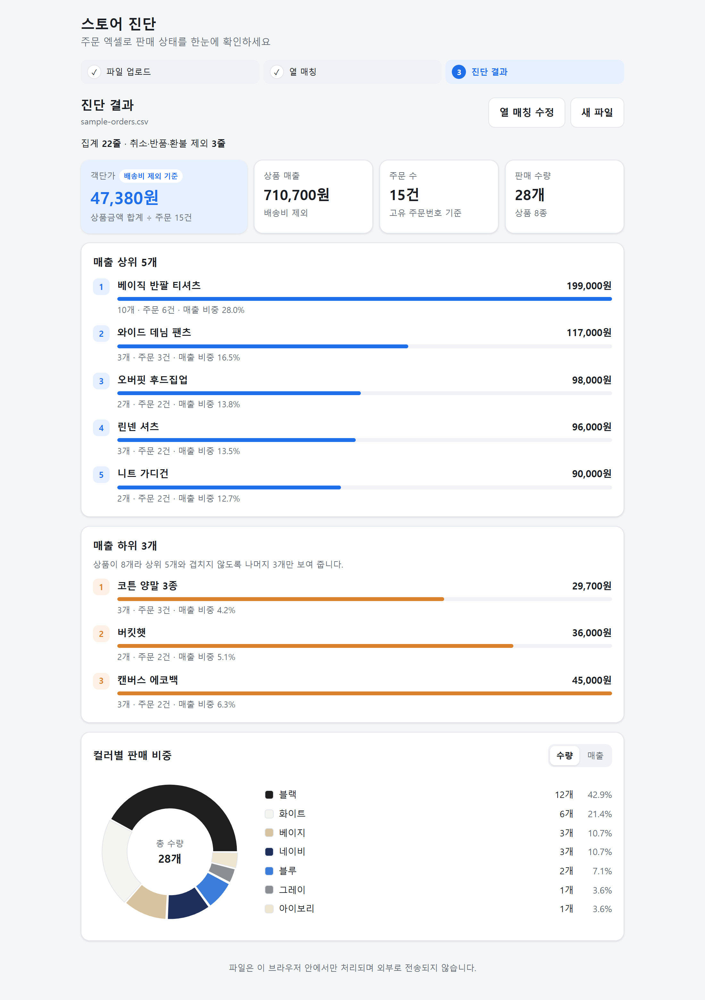
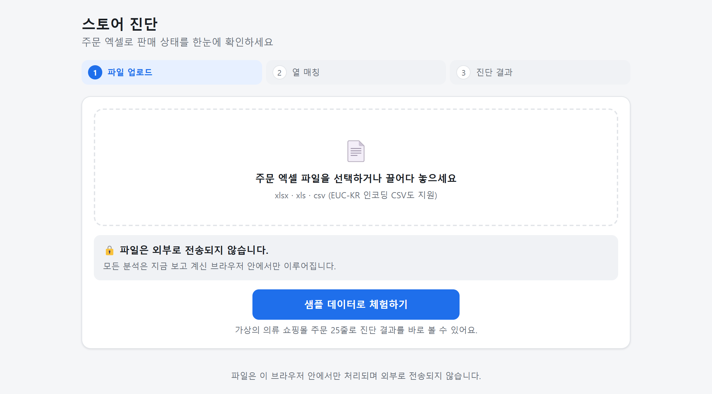
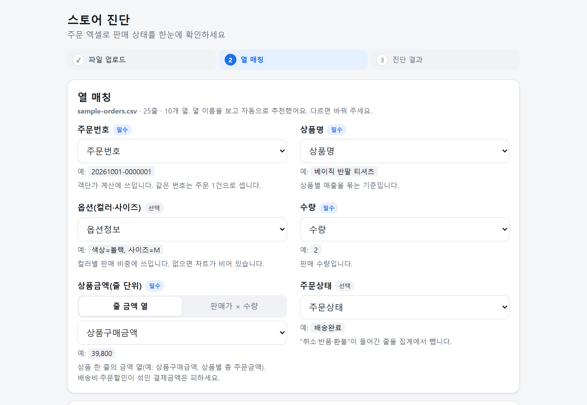
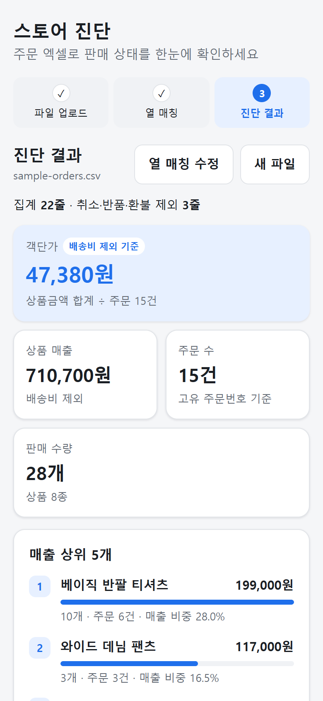
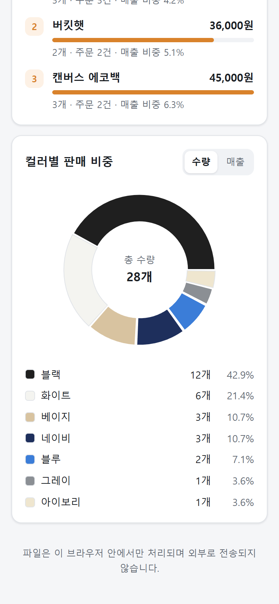

# 스토어 진단

쇼핑몰 주문 엑셀(xlsx/csv)을 올리면 상품별 매출, 컬러별 판매 비중, 객단가를 바로 보여 주는 웹앱입니다.
파일은 브라우저 안에서만 처리되며 어디에도 전송되지 않습니다.

**🔗 데모:** https://store-diagnosis.vercel.app — 첫 화면의 "샘플 데이터로 체험하기"를 누르면 바로 결과를 볼 수 있습니다.



<table>
  <tr>
    <th>1. 업로드</th>
    <th>2. 열 매칭</th>
  </tr>
  <tr>
    <td></td>
    <td></td>
  </tr>
</table>

<table>
  <tr>
    <th>모바일 · 요약</th>
    <th>모바일 · 컬러별 비중</th>
  </tr>
  <tr>
    <td align="center"></td>
    <td align="center"></td>
  </tr>
</table>

## 만든 이유

의류 쇼핑몰에서 MD로 일하면서 판매 현황을 볼 때마다 주문 엑셀을 내려받아 수작업으로 정리했습니다.
피벗 테이블을 다시 만들고, 옵션 열에서 컬러를 손으로 나누고, 취소·반품 건을 걸러 내는 일이 매번 반복됐습니다.

쇼핑몰마다 엑셀 열 이름이 다르고, 매출로 착각하기 쉬운 "결제금액"이 사실은 주문 단위 금액이라
상품별로 합치면 숫자가 부풀려지는 문제도 있었습니다.
이 반복 작업을 **파일 업로드 → 열 매칭 → 결과 확인** 세 단계로 줄이려고 만들었습니다.

## 주요 기능

- **파일 업로드**: xlsx · xls · csv 지원. EUC-KR로 저장된 국내 쇼핑몰 CSV도 한글이 깨지지 않습니다.
- **열 매칭**: 열 이름을 보고 주문번호 · 상품명 · 옵션 · 수량 · 상품금액 · 주문상태를 자동으로 추천하고, 사용자가 직접 고칠 수 있습니다.
  - 상품금액은 "줄 금액 열"과 "판매가 × 수량" 중에서 계산 방식을 고를 수 있습니다.
  - 주문 단위 결제금액을 고르면 경고를 띄웁니다.
- **진단 결과**
  - 객단가 (상품금액 합계 ÷ 고유 주문 수, **배송비 제외 기준**)
  - 상품 매출, 주문 수, 판매 수량
  - 매출 상위 5개 / 하위 5개 (서로 겹치지 않게 표시)
  - 컬러별 판매 비중 도넛 차트 (수량·매출 기준 전환)
- **취소·반품·환불 제외**: 주문상태 열을 매칭하면 해당 줄을 빼고, 몇 줄을 뺐는지 보여 줍니다.
- **실무 엑셀 대응**: 맨 위 제목 줄 자동 건너뛰기, 합계 행 제거, 병합 셀로 비어 있는 주문번호 이어받기
- **샘플 데이터로 체험하기**: 버튼 한 번으로 가상 주문 데이터의 진단 결과를 볼 수 있습니다.
- **모바일 대응**, 다크 모드

## 사용 기술

| 영역 | 기술 |
|---|---|
| 프레임워크 | React 18, TypeScript, Vite |
| 엑셀 파싱 | SheetJS (xlsx), TextDecoder (EUC-KR 판별) |
| 차트 | Recharts |
| 테스트 | Vitest |
| 스타일 | CSS 변수 기반 반응형 CSS |

서버 없이 정적 파일만으로 동작합니다.

## 실행 방법

Node.js 18 이상이 필요합니다.

```bash
npm install
npm run dev      # http://localhost:5173
npm test         # 단위 테스트
npm run build    # dist/ 에 배포용 파일 생성
```

## 폴더 구조

```
src/
├─ App.tsx                 # 업로드 → 열 매칭 → 결과 단계 전환
├─ types.ts
├─ lib/
│  ├─ parseFile.ts         # xlsx/csv 파싱, 인코딩 판별, 헤더 행 탐지
│  ├─ guessMapping.ts      # 열 이름으로 매칭 추천
│  ├─ normalize.ts         # "12,900원" → 12900, 취소/반품/환불 판별
│  ├─ parseOption.ts       # "색상=블랙, 사이즈=M" → 블랙
│  ├─ analyze.ts           # 집계
│  └─ __tests__/
└─ components/             # 업로드, 열 매칭, 요약 카드, 순위, 컬러 차트
public/sample-orders.csv   # 개인정보 없는 가상 주문 데이터
```

## AI와 작업한 방식

이 프로젝트는 **Claude Code**와 함께 설계하고 구현했습니다.
저는 요구사항과 판단 기준을 정하고, 결과가 실무 데이터에 맞는지 직접 검증했습니다.

**진행 방식**

1. 목적과 1단계 범위를 정해 전달하고, 폴더 구조와 작업 계획을 먼저 받아 검토한 뒤 구현을 시작했습니다.
2. 단계마다 진행 상황을 `WORK_STATUS.md`에 기록하게 해서 무엇이 끝났고 무엇이 남았는지 추적했습니다.
3. 집계 로직은 단위 테스트로, 화면은 실제 브라우저(모바일 폭 포함)에서 확인했습니다.

**제가 직접 검증하고 방향을 바꾼 부분**

- **매출 기준을 결제금액에서 상품금액으로 변경**:
  처음 계획은 "결제금액" 열로 매출을 계산하는 것이었습니다.
  하지만 카페24 등 실제 쇼핑몰 엑셀의 결제금액은 주문 단위라, 한 주문에 상품이 여러 개면 줄마다 같은 금액이 반복되고 배송비·할인도 섞여 있습니다.
  그래서 상품별 매출은 줄 단위 상품금액(또는 판매가 × 수량)으로 계산하고,
  객단가는 상품금액 합계 ÷ 고유 주문 수로 "배송비 제외 기준"을 명시하도록 바꿨습니다.
- **취소·반품·환불 제외**:
  실제 판매 현황을 보려면 취소·반품 건을 빼야 한다고 판단했습니다.
  그래서 주문상태 열을 선택 항목으로 추가하고, 제외한 줄 수를 화면에 표시하도록 요구했습니다.
- **상·하위 목록 중복 처리**:
  상품 수가 적을 때 상위 5개와 하위 5개가 같은 상품으로 채워지지 않는지 확인했습니다.
  상품이 5개 이하면 하위 목록 대신 안내 문구를 보여 주고, 6~9개면 상위와 겹치지 않는 나머지만 보여 주도록 정리했습니다.
- 샘플 데이터에 이름·전화번호·주소 같은 개인정보가 없는지 확인했습니다.

## 다음에 하고 싶은 것

- 주문일시 기준 기간별 추이
- 사이즈별 판매 비중, 컬러 × 사이즈 조합 분석
- 진단 결과를 이미지·PDF로 저장
